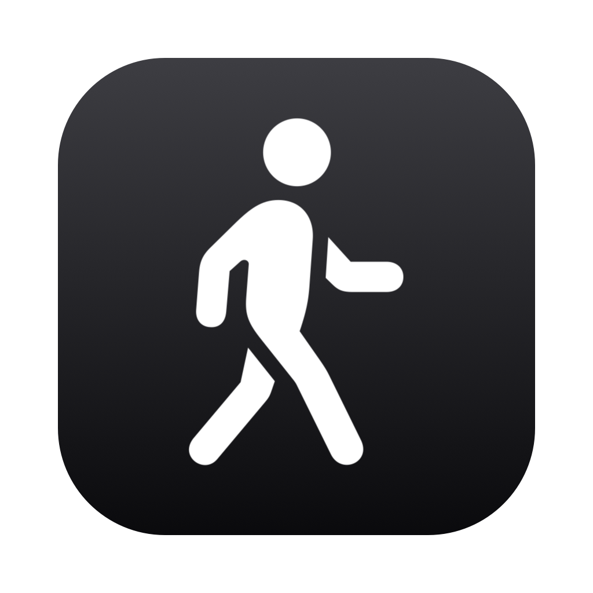

<div align="center">



# Deskwalk

**Drive your WalkingPad from the Mac menu bar.**
Start walking from a launcher shortcut, see your steps in the menu bar, and send every session to Apple Health.


</div>

## ✨ Features

**Walk**

- 🚶 **Menu bar**: steps and time while the belt runs, the icon greys out when the pad is out of reach
- ▶️ **Go / Stop** from the menu, or from any launcher through a URL
- 🎚️ **Default speed**: pick a speed once, Go starts at it every time (1 to 6 km/h)
- 📊 **Session** in the menu: minutes, distance, steps

**Connect**

- 🔗 **URL scheme**: `deskwalk://go`, `deskwalk://stop`, `deskwalk://speed/3.5`
- ❤️ **Apple Health**: each session lands in iCloud Drive as JSON, an iPhone Shortcut logs it to Health
- 🔌 **Launch at login**: one tick in the menu

**App**

- 🪶 One Swift file, no Xcode project, no dependency
- 🔵 Talks to the pad directly over Bluetooth LE, no pairing

## 🚀 Run it

```sh
brew install --cask mathieuletyrant/tap/deskwalk
```

Apple Silicon, macOS 26. Allow Bluetooth on the first launch. Update with `brew update && brew upgrade`.

> [!IMPORTANT]
> The pad accepts **one** Bluetooth connection. Quit KS Fit on your phone (or turn the phone's Bluetooth off), or the Mac never finds it.

Supported: WalkingPad **A1, R1, C2, P1** (the KingSmith `FE00` protocol). The app connects to the first device whose name contains `walkingpad` or starts with `KS-`.

## ⌨️ Launchers

Anything that opens a URL works: Raycast, Alfred, Shortcuts, a terminal.

```sh
open deskwalk://go          # manual mode, start the belt, then the default speed
open deskwalk://speed/4     # change speed now
open deskwalk://stop
```

## ❤️ Apple Health

macOS has no Health store, so the iPhone writes it. When the belt stops after a minute or more, Deskwalk saves the session to **iCloud Drive → Shortcuts → Deskwalk** as `<timestamp>.json`:

```json
{
  "start": "2026-11-26T10:00:00+01:00",
  "end": "2026-11-26T10:45:00+01:00",
  "durationMin": 45,
  "distanceKm": 2.31,
  "steps": 4210
}
```

**[📲 Install the Shortcut](https://github.com/mathieuletyrant/deskwalk-app/raw/main/shortcut/Deskwalk.shortcut)**: open the link on the iPhone, then **Add Shortcut**. It logs each session's steps and walking distance to Health, then deletes the file.

Run it once by hand to grant Files and Health access. Then a personal automation (e.g. _When charger is connected_, _Run Immediately_) runs it on its own.

<details>
<summary>Build it by hand instead</summary>

1. **Get File**: `Deskwalk/` in the Shortcuts folder, then **Get Contents of Folder**
2. **Repeat with Each**, then **Get Dictionary from Input**
3. **Log Health Sample**: Step Count = `steps`, from `start` to `end`
4. **Log Health Sample**: Walking + Running Distance = `distanceKm` km, from `start` to `end`
5. **Delete Files**: the item, without confirmation

</details>

## 🛠️ Develop

```sh
./build.sh             # protocol self-test, build build/Deskwalk.app
./build.sh install     # same, then copy to /Applications and relaunch
./build.sh release     # bump the patch version, tag, push: CI publishes the release and the cask
```

```
main.swift   the whole app: WalkingPad protocol, BLE client, session export, menu bar
icon.swift   renders docs/icon.png, turned into AppIcon.icns by build.sh
Info.plist   bundle: menu bar only, Bluetooth usage, deskwalk:// scheme
shortcut/    the iPhone Shortcut and the script that builds and signs it (swift shortcut/build.swift)
```

The protocol comes from [ph4-walkingpad](https://github.com/ph4r05/ph4-walkingpad): 6-byte frames `F7 A2 <cmd> <value> <crc> FD` written to `FE02`, status frames `F8 A2 …` notified on `FE01`, one command every 0.7 s.
